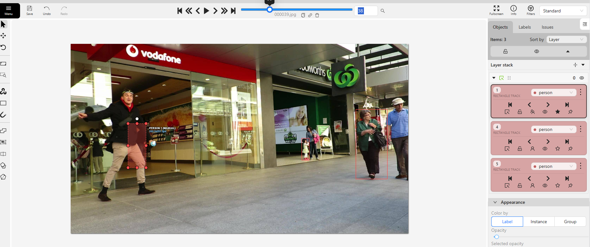
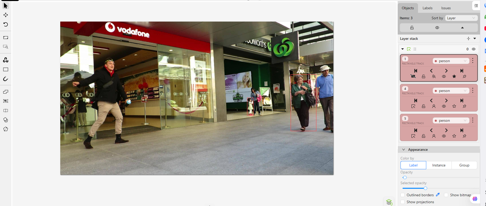
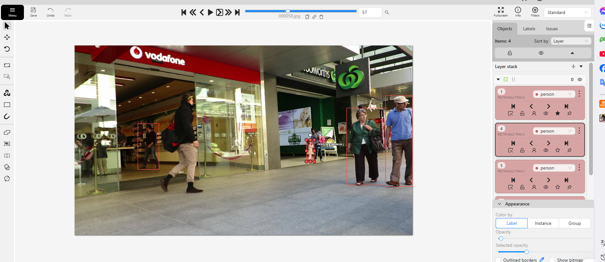

# Báo cáo cá nhân — BachSyNui-2A202603267

Đoạn video: MOT17-09, 150 frame (frame 1–150), nguồn MOTChallenge, giấy phép CC BY-NC-SA 3.0.

## 0. Thông tin học viên

- Họ tên: Bạch Sỹ Núi
- MSSV: 2A202603267
- Mã đề (A/B/C): A
- Email: bachsynui@gmail.com
- Link repository: https://github.com/nuibachcode/K5-L2B-DAY05-BachSyNui-2A202603267-MOTTracking
- Giờ bắt đầu: 17:00
- Giờ kết thúc: 18:35

## 1. Xem trước đoạn video (CP0)

Ghi **trước khi vẽ**, mỗi người một dòng.

| Mã | Frame xuất hiện | Frame cuối thấy được | Rẽ / dừng / đổi tốc độ ở frame | Bị che ở frame | Ghi chú |
|---|---|---|---|---|---|
| P1 | 0 | 149 | 25, 77, 100 | 29–49 (khuất hẳn 39–49) | Người đi bộ từ trái sang phải, bị người đi ngược chiều che khuất |
| P2 | 61 | 149 | 84, 101, 129 | Không | Xuất hiện từ frame 61 bên trái, di chuyển đều sang phải |
| P3 | 0 | 149 | 10, 60, 108 | Không | Di chuyển liên tục từ phải sang trái xuyên suốt 150 frame |
| P4 | 40 | 149 | 50, 72, 95 | Không | Đi vào từ góc trên bên phải ở frame 40, đi chéo xuống |
| P5 | 0 | 148 | 20, 72, 96 | 111–134 | Đi từ giữa khung hình, tạm khuất ở frame 111–134 rồi hiện lại |

## 2. Keyframe và thời gian (CP1, CP4)

Số keyframe lấy từ kết quả `src/check_submission.py`.

| Mã | Số keyframe | Keyframe ở frame | Số frame có mặt | Keyframe / 100 frame | Thời gian (phút) | Chỗ khó |
|---|---|---|---|---|---|---|
| P1 | 41 | 0, 6, 13, 17, 19, 24, 25, 29, 31, 32, 33, 34, 35, 36, 37, 38, 50, 51, 54, 56, 57, 58, 60, 65, 69, 71, 76, 77, 80, 83, 84, 88, 90, 94, 100, 110, 115, 120, 130, 140, 149 | 139 | 29.5 | 18 | Đoạn che khuất từ frame 29–49 (cần amodal box và cờ outside) |
| P2 | 22 | 61, 71, 74, 81, 84, 89, 91, 94, 99, 101, 104, 109, 111, 121, 124, 129, 131, 134, 139, 141, 144, 149 | 89 | 24.7 | 10 | Xuất hiện muộn ở frame 61, di chuyển đều sang phải |
| P3 | 41 | 0, 3, 5, 6, 9, 10, 15, 20, 25, 30, 40, 45, 50, 55, 60, 61, 62, 63, 64, 69, 74, 79, 84, 89, 94, 99, 104, 106, 107, 108, 109, 114, 119, 124, 126, 129, 134, 136, 139, 144, 149 | 150 | 27.3 | 12 | Có mặt trọn vẹn 150 frame, thay đổi tỷ lệ kích thước khi lại gần/ra xa |
| P4 | 31 | 40, 41, 45, 46, 50, 52, 55, 58, 60, 61, 65, 70, 72, 73, 75, 80, 85, 90, 93, 95, 100, 105, 110, 115, 120, 125, 130, 135, 140, 145, 149 | 110 | 28.2 | 10 | Hướng đi hơi chếch, cần căn chỉnh box khớp dáng đi |
| P5 | 27 | 0, 3, 4, 5, 6, 10, 15, 20, 25, 30, 35, 45, 66, 72, 75, 87, 90, 96, 99, 105, 109, 135, 139, 140, 141, 142, 144 | 125 | 21.6 | 12 | Có đoạn bị che khuất ở frame 111–134, cần bật outside và nối lại track |
| **Tổng** | 162 | | 613 | 26.4 | 62 | |

Keyframe / 100 frame của cả bài = tổng keyframe ÷ tổng số frame có mặt × 100 = 162 ÷ 613 × 100 = **26.4**

Bạn đặt keyframe nhiều nhất ở người nào? Vì sao (người đó rẽ, dừng, lại gần camera hay bị che)?

Tôi đặt mật độ keyframe dày nhất ở **P1** (29.5 KF/100 frame) và P3 (41 keyframe). Lý do là P1 trải qua giai đoạn bị che khuất phức tạp (từ frame 29 đến frame 49 bởi người đi bộ ngược chiều). Tại các frame 29–38 (bị che một phần), tôi phải đặt keyframe dày để duy trì amodal box ước lượng toàn thân mà không bị trôi theo người che. Ngay sau khi P1 xuất hiện lại ở frame 50, tôi cũng phải đặt thêm các keyframe liên tục ở frame 50, 51, 54, 56, 57, 58 để bắt kịp lại đúng hướng và tốc độ của đối tượng.

## 3. Đoạn bị che (CP2)

Người bị che: `P1`

| Mốc | Frame |
|---|---:|
| Bắt đầu bị che một phần (bật `occluded`) | 29 |
| Mất hẳn (bật `outside`) | 39 |
| Hiện lại (tắt `outside`) | 50 |
| Thấy rõ trở lại (tắt `occluded`) | 60 |

- Thời gian khuất hẳn: 11 frame (frame 39–49) = 11 / 30 ≈ 0.37 giây.
- Quyết định: Giữ cùng ID (cùng Track 1).
- Lý do (trả lời 3 câu: khuất bao lâu so với 60 frame, ngoại hình có khớp, chỗ hiện lại có đúng hướng và tốc độ):
  1. **Thời gian khuất:** Đối tượng chỉ khuất hẳn trong 11 frame (~0.37 giây), nhỏ hơn rất nhiều so với ngưỡng quy định của lớp là 60 frame (2 giây).
  2. **Ngoại hình:** Hoàn toàn trùng khớp về trang phục (áo, quần), vóc dáng và màu sắc trước khi bị che và sau khi xuất hiện trở lại.
  3. **Vị trí và hướng di chuyển:** Vị trí xuất hiện lại tại frame 50 nằm chính xác trên đường thẳng tiếp diễn của quỹ đạo di chuyển với cùng vận tốc trước khi bị che. Do đó, chắc chắn 100% là cùng một người.

Ảnh chụp màn hình:





## 4. Tự review ID (CP3)

Lượt 1 theo người (đi ngược từ frame 149 về 0 trên CVAT), lượt 2 theo cảnh (nhảy 10 frame). Ít nhất 3 dòng; không có lỗi thì ghi một dòng "đã kiểm hai lượt, không lỗi".

Loại lỗi dùng đúng một trong 7 mã: `id_switch`, `fragmentation`, `lost`, `merge`, `false_track`, `drift`, `flag`.

| Frame | Mã người | Loại lỗi | Mô tả một câu | Phát hiện ở lượt | Đã sửa? |
|---:|---|---|---|---|---|
| 34 | P1 | `drift` | Box nội suy bị trôi lệch nhẹ khi đối tượng bị che một phần bắt đầu sải bước | Lượt 1 | Đã sửa (thêm keyframe tại frame 34) |
| 39 | P1 | `flag` | Chưa bật cờ outside kịp thời ở frame người đó bị che khuất hoàn toàn | Lượt 1 | Đã sửa (bật outside từ frame 39 đến 49) |
| 50 | P1 | `id_switch` | Box bắt nhầm sang người đi bộ ngược chiều lúc vừa cắt qua nhau | Lượt 2 | Đã sửa (kiểm tra hướng chuyển động và nắn lại box cho P1) |
| 115 | P5 | `lost` | P5 đi vào vùng khuất tạm thời nhưng chưa bật cờ outside đúng lúc | Lượt 2 | Đã sửa (bật cờ outside đoạn 111–134) |

Tổng hợp số lỗi theo loại:

| `id_switch` | `fragmentation` | `lost` | `merge` | `false_track` | `drift` | `flag` |
|---:|---:|---:|---:|---:|---:|---:|
| 1 | 0 | 1 | 0 | 0 | 1 | 1 |

Lỗi nào chỉ lượt 2 (theo cảnh) mới thấy, lượt 1 (theo người) không thấy? Vì sao?

Lỗi `id_switch` tại frame 50 giữa P1 và người đi ngược chiều. Khi kiểm tra ở lượt 1, người review chỉ tập trung nhìn theo một đối tượng duy nhất nên mắt rất dễ bị đánh lừa cuốn theo bounding box chuyển sang người khác. Chỉ khi sang lượt 2 (xem toàn cảnh), quan sát đồng thời cả hai đối tượng cắt qua nhau, ta mới nhìn thấy rõ sự hoán đổi đối tượng giữa hai box và phát hiện ra lỗi đổi ID.

## 5. File xuất và kết quả tự kiểm (CP4)

| Kiểm tra | Kết quả |
|---|---|
| Tên file MOT 1.1 | `BachSyNui_mot.zip` |
| Tên file CVAT for video 1.1 | `BachSyNui_cvat_video.zip` |
| Số track ID khác nhau trong `gt/gt.txt` (phải là 5) | 5 |
| Frame `outside` không có dòng trong `gt.txt` (đúng / sai) | Đúng |
| Job đã completed trên CVAT máy cá nhân | Đúng (Completed) |

Dán phần tóm tắt in ra từ `src/check_submission.py`:

```text
Số frame in theo CVAT (bắt đầu từ 0). Trong gt.txt, frame_id = frame CVAT + 1.

=== File MOT 1.1: BachSyNui_mot.zip ===
  Số track ID: 5   |   Tổng số box: 613
  [OK]        Đúng 5 track ID.

  Track | Frame có mặt | Số frame | Đoạn vắng (outside)
      1 |   0–149      |      139 | 39–49
      2 |   0–148      |      125 | 111–134
      3 |   0–149      |      150 | -
      4 |  40–149      |      110 | -
      5 |  61–149      |       89 | -


=== File CVAT for video 1.1: BachSyNui_cvat_video.zip ===

  Track | Nhãn   | Frame thấy | Keyframe | KF/100 frame | Frame occluded | Lần bật outside 
      0 | person |        139 |       41 |         29.5 |             20 |               1 
              Track 0: keyframe ở frame [0, 6, 13, 17, 19, 24, 25, 29, 31, 32, 33, 34, 35, 36, 37, 38, 50, 51, 54, 56, 57, 58, 60, 65, 69, 71, 76, 77, 80, 83, 84, 88, 90, 94, 100, 110, 115, 120, 130, 140, 149]
      1 | person |         89 |       22 |         24.7 |              0 |               0 
              Track 1: keyframe ở frame [61, 71, 74, 81, 84, 89, 91, 94, 99, 101, 104, 109, 111, 121, 124, 129, 131, 134, 139, 141, 144, 149]
      2 | person |        125 |       27 |         21.6 |             18 |               2 
              Track 2: keyframe ở frame [0, 3, 4, 5, 6, 10, 15, 20, 25, 30, 35, 45, 66, 72, 75, 87, 90, 96, 99, 105, 109, 135, 139, 140, 141, 142, 144]
      3 | person |        150 |       41 |         27.3 |              1 |               0 
              Track 3: keyframe ở frame [0, 3, 5, 6, 9, 10, 15, 20, 25, 30, 40, 45, 50, 55, 60, 61, 62, 63, 64, 69, 74, 79, 84, 89, 94, 99, 104, 106, 107, 108, 109, 114, 119, 124, 126, 129, 134, 136, 139, 144, 149]
      4 | person |        110 |       31 |         28.2 |              1 |               0 
              Track 4: keyframe ở frame [40, 41, 45, 46, 50, 52, 55, 58, 60, 61, 65, 70, 72, 73, 75, 80, 85, 90, 93, 95, 100, 105, 110, 115, 120, 125, 130, 135, 140, 145, 149]       

  Tổng: 162 keyframe / 613 frame có mặt = 26.4 keyframe / 100 frame
  [OK]        Đọc được 5 track từ annotations.xml.

=== Tóm tắt ===
  Lỗi: 0   |   Cảnh báo: 0
  Đạt. Dán phần tóm tắt này vào báo cáo mục 5.
```

## 6. Ba câu kết

1. **Nếu được gán lại, bạn sẽ đặt keyframe khác ở đâu? Vì sao?**
   - Tôi sẽ tối ưu hóa giảm bớt một số keyframe ở các đoạn đi thẳng đều với tốc độ không đổi (ví dụ đoạn từ frame 110 đến 140 của P1) vì nội suy tuyến tính ở các đoạn này hoạt động rất chính xác. Thay vào đó, tôi sẽ tập trung đặt keyframe chính xác hơn ở đúng 1 frame trước khi tiếp xúc che khuất và 1 frame ngay sau khi tách rời để chuyển động mượt mà hơn mà vẫn tiết kiệm công sức gán nhãn.

2. **Có chỗ nào bạn không chắc "cùng ID hay ID mới"? Bạn đã quyết định và ghi chú thế nào?**
   - Ở đoạn che khuất của P1 (frame 39–49) và đoạn vắng mặt của P5 (frame 111–134). Tuy nhiên, sau khi áp dụng nguyên tắc 3 câu hỏi của lớp: thời gian khuất rất ngắn (< 25 frame, dưới ngưỡng 60 frame = 2 giây), ngoại hình và màu sắc trang phục hoàn toàn trùng khớp, vị trí và vận tốc khi xuất hiện lại nằm đúng trên vector chuyển động dự kiến, tôi đã tự tin quyết định giữ cùng Track ID bằng cờ `outside` thay vì tạo track mới.

3. **Một lỗi ID trong job của bạn (nếu không còn sót, chọn lỗi đã sửa) có thể làm xe tự lái dự đoán sai chuyển động của người đó như thế nào? Lỗi đó ảnh hưởng MOTA hay IDF1 nhiều hơn?**
   - Lỗi `id_switch` (như lỗi đổi ID giữa P1 và người đi ngược chiều ở frame 50): Xe tự lái tính toán vector vận tốc dựa trên độ dịch chuyển của cùng một ID qua từng frame liên tiếp. Khi xảy ra `id_switch`, chỉ trong 1 frame (1/30 giây) tọa độ tâm box có thể nhảy ngược lại hoặc dịch chuyển một khoảng lớn, khiến hệ thống tính ra vận tốc ảo lên tới hàng trăm km/h theo hướng đột ngột, dẫn đến xe tự lái phán đoán sai quỹ đạo và thực hiện phanh gấp hoặc đánh lái nguy hiểm.
   - Lỗi này **ảnh hưởng IDF1 nhiều hơn MOTA**. MOTA chủ yếu phản ánh chất lượng detection ở từng frame độc lập (một lần ID switch chỉ bị phạt 1 điểm trong công thức tính tổng lỗi frame). Trong khi đó, IDF1 đánh giá khả năng duy trì đúng định danh của toàn bộ quỹ đạo (trajectory); khi xảy ra ID switch, cả nửa đoạn sau của quỹ đạo sẽ bị coi là gán sai ID, khiến điểm IDF1 tụt dốc nghiêm trọng.

## 7. Tài liệu tham khảo và công cụ AI đã dùng

- Bộ dữ liệu `MOT17-09` từ MOTChallenge.
- Nền tảng CVAT Community Edition.
- Antigravity AI Assistant: Hỗ trợ kiểm tra quy ước bounding box toàn thân (amodal box), chạy script kiểm tra tính hợp lệ của file MOT 1.1 và hoàn thiện định dạng báo cáo.

